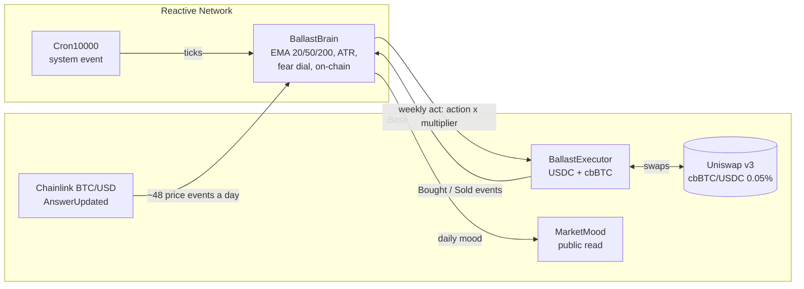

# Ballast

**DCA that adds weight when the market storms.**

Ships take on ballast to stay steady in rough seas. Ballast does the same for a BTC savings plan: the worse the market, the more it buys.

**Demo video (2:22):** https://youtu.be/gx9GPTDA1ts

**Live dashboard:** https://ballast-dca.github.io/ballast/

Ballast is a weekly dollar-cost-averaging plan for BTC that runs entirely on-chain, with no server, no bot and no keys online. A reactive contract on [Reactive Network](https://reactive.network) watches the Chainlink BTC/USD feed on Base, computes the 200-day average and trend indicators on-chain, and tells an executor on Base how much to buy each week: more when BTC is cheap relative to its long-term average, less when it is overheated.

> Ballast turns "be greedy when others are fearful" into a contract that cannot flinch.

Built for the Reactive Omni Buildathon, track **Set It and Forget It**.

---

## The edge, and what it costs

Plain DCA buys the same amount every week. Ballast's **fear dial** scales the weekly buy by how far BTC's daily close sits from its 200-day average:

| BTC vs its 200-day average | Weekly buy |
|---|---|
| at or above it, up to 30% above | 1x |
| 10% below | 1.5x |
| 20% below | 2x |
| 40% or more below | 3x (cap) |
| 50% above | 0.8x |
| 80% or more above | 0.5x (floor) |

These figures use the exact rule the contract implements. We tested it against plain weekly DCA over **71 rolling two-year windows** (monthly starts, January 2019 to November 2024, Coinbase daily candles, 0.5% fee):

| | BTC plain | BTC fear dial | ETH plain | ETH fear dial |
|---|---|---|---|---|
| Median return on money invested | 75% | 75% | 30% | **37%** |
| Worst two-year window | -49% | **-40%** | -40% | **-34%** |
| Chance of a loss after two years | 31% | **24%** | 37% | **28%** |
| Cheaper average purchase price | | **7.3%** | | **10.5%** |
| Beat plain DCA (return) | | **64 of 71** | | **65 of 71** |
| Ended with more dollars of profit | | **53 of 71** | | **56 of 71** |
| Money put in, vs plain | 1.00x | 1.24x | 1.00x | 1.31x |

A worked example. $50 a week from the November 2021 top, two years later:

| | Plain | Fear dial |
|---|---|---|
| Invested | $5,250 | $8,313 |
| BTC bought | 0.196 | 0.334 |
| Average cost | $26,825 | $24,904 |
| Return | +37% | +47% |

In a calm bull market (October 2023 to March 2024) the dial barely acts: +82% against +80% for plain, on slightly less money.

**What it costs you:**
- **Spare cash in crashes.** The dial spends up to 3x the normal amount in deep drawdowns, about 25 to 30% more over a two-year window. A monthly cap bounds it.
- **Bigger dollar swings.** More money goes in near the bottom, so dollar drawdowns are larger even when percentage drawdowns are smaller.
- **It assumes recovery.** Buying more of something that never recovers loses more. That is what **Shield** mode is for.
- **History is not a promise.** 2019 to 2026 only. Code in [`research/`](research/).

We also tested a drawdown-from-high dial, an RSI dial and value averaging. The drawdown dial spent far more for the same result, the RSI dial barely beat plain DCA, and value averaging had the best return per dollar but less total profit in bull markets. The fear dial was the best all-rounder.

---

## Two modes

**ACCUMULATE (default).** Buy every week, sized by the fear dial. Never sells.

**SHIELD.** For people who care more about not losing than about maximum gain. The weekly budget accumulates in USDC and is only invested while the trend is up (daily close above EMA200 and EMA20 above EMA50). When the trend breaks, or price hits a disaster stop at the last buy price minus 3x ATR, it exits to USDC.

| Two-year windows | BTC plain DCA | BTC Shield (trend rule, tested without the stop) |
|---|---|---|
| Median return | 75% | 41% |
| Worst window | -49% | **-6%** |
| Chance of a loss | 31% | **14%** |
| Average max drawdown | 56% | **41%** |

Shield gives up roughly half the median return for a much better worst case. The owner switches modes with one call.

## Make it yours

Weekly is the default, not a limit. Every setting is one owner call, with no redeploy:

| Setting | Call | Example |
|---|---|---|
| Cadence | `BallastBrain.setInterval(seconds)` | `86400` for daily, `1209600` for every two weeks |
| Amount per period | `BallastExecutor.setWeekly(usdc)` | `25000000` for $25 per period (6 decimals) |
| Spending ceiling | `BallastExecutor.setMonthlyCap(usdc)` | `300000000` caps dial-boosted buys at $300 per 30 days; `0` for no cap |
| Slippage guard | `BallastExecutor.setSlippageBps(bps)` | `50` for 0.5% against Chainlink |
| Strategy | `BallastBrain.setMode(1 or 2)` | `1` ACCUMULATE (fear dial), `2` SHIELD (trend-gated with exits) |
| Pause | `BallastBrain.pause()` / `resume()`, `BallastExecutor.setPaused(bool)` | stop paying for reactions, or stop trading |
| Exit | `BallastExecutor.withdraw(token, to, amount)` | take USDC or cbBTC out at any time |

```
cast send $BRAIN "setInterval(uint256)" 86400 --rpc-url https://mainnet-rpc.rnk.dev/ --account <you>
cast send $EXECUTOR "setWeekly(uint256)" 25000000 --rpc-url https://mainnet.base.org --account <you>
```

The cadence can be anything from about 2 hours up: the brain checks it on every Reactive `Cron10000` tick, which arrives roughly every 2.2 hours on mainnet (measured). Fewer, larger buys and more, smaller buys both work; the dial sizes each one the same way. The backtests above use weekly buys and the default dial, so other settings are untested variations of the rule.

---

## How it works



**BallastBrain** (reactive contract, Reactive mainnet) subscribes to three event streams:

1. **Chainlink BTC/USD `AnswerUpdated` on Base.** From these updates the brain builds daily high, low and close and keeps EMA20, EMA50, EMA200 and a Wilder ATR14 on-chain.
2. **Reactive's Cron10000** system event. Once a week the brain sends the buy, with the fear-dial multiplier attached.
3. **BallastExecutor's `Bought` and `Sold` events on Base.** The brain's view of the position follows what actually happened on-chain.

**BallastExecutor** (callback contract, Base) holds USDC and cbBTC and only executes. Every swap is checked against the Chainlink price read directly on Base, with a 1% slippage limit and a 2-hour staleness limit. Each action emits `Explained(round, action, multiplier, distanceBps)`, so every decision can be read back in plain terms: *"bought 2x because BTC closed 20% below its 200-day average."*

**MarketMood** (Base) is a public good. Once a day the brain writes BTC's distance from its 200-day average, the trend state and the coming week's multiplier. Any contract can read it, for example to tighten lending limits when `inFear(2000)` is true.

---

## Safety

- **Only the brain can act**, and only through Reactive's callback proxy (`onlyServiceProvider` plus `onlyCallbackSender`).
- **Idempotent.** Every action carries a round number; repeats are ignored.
- **Skip, never revert.** A stale oracle, a failed swap, a slippage breach or the monthly cap records a `Skipped` event and the callback settles. Reactive bills failed callbacks and does not retry them.
- **Exits retry.** In Shield mode, if an exit is skipped, the brain re-issues it at each daily close until the `Sold` event comes back.
- **The stop blocks re-entry** until the trend resets.
- **Owner controls.** Executor: pause, withdraw any token, weekly amount, monthly cap, slippage. Brain: mode, pause and resume subscriptions.

---

## Costs

| | Per | Notes |
|---|---|---|
| Price reactions | ~0.012 to 0.016 REACT | about 48 a day |
| Cron ticks | ~0.014 REACT | about 11 a day, billed whether or not anything happens |
| Total on Reactive | ~0.9 REACT a day | live mainnet fee parameters (Reactive MCP `estimate_cost`) |
| Base callbacks | fractions of a cent of ETH | one weekly action, one daily mood update |
| Swap cost | ~0.05% pool fee | a forked-mainnet round trip measured about 0.10% |

---

## Repository

```
src/BallastBrain.sol       reactive contract (Reactive Network)
src/BallastExecutor.sol    callback contract (Base)
src/MarketMood.sol        public mood read (Base)
test/Ballast.t.sol         unit tests: brain logic against a mocked system contract,
                          executor against a fork of Base mainnet, MarketMood
test/BallastFuzz.t.sol     property tests: the dial stays in [0.5x, 3x] and never buys
                          less at a lower price, ACCUMULATE never sells on random
                          price paths, rounds only increase, the budget never
                          exceeds funds (fork), MarketMood never goes back in time
docs/index.html            live dashboard (GitHub Pages), reads Base directly
script/seed.py            seed EMAs and ATR from completed daily candles
script/deploy.sh          deploy, link, seed and fund all three contracts
research/                 the backtests behind the rules
```

```bash
forge install Reactive-Network/reactive-lib-omni@3ade0dcf1d27e67e5783ef807e73a1b9e0c0cce8
forge test
```

The fork tests use `https://mainnet.base.org` by default; set `BASE_RPC` to use another endpoint.

---

## Deployments

All three are verified on Sourcify (exact match).

| Contract | Chain | Address |
|---|---|---|
| BallastBrain | Reactive mainnet (1597) | [`0x1F013aED0ad6069aE1340Df39c95EC1d34B7A205`](https://reactscan.net/address/0x1F013aED0ad6069aE1340Df39c95EC1d34B7A205) |
| BallastExecutor | Base (8453) | [`0x617296f5E7174093a6EA7E4C68fe73cef2658d7c`](https://basescan.org/address/0x617296f5E7174093a6EA7E4C68fe73cef2658d7c) |
| MarketMood | Base (8453) | [`0x6F9d5d4ce09755DF50281baf66043C069Aeb4964`](https://basescan.org/address/0x6F9d5d4ce09755DF50281baf66043C069Aeb4964) |

### The first live loop (weekly buy at 1.95x, BTC 19% below its 200-day average)

| # | Step | Chain | Transaction |
|---|---|---|---|
| 1 | Cron10000 tick (origin event) | Reactive, block 10,560,000 | [`0x3e5e9178...49fc`](https://reactscan.net/tx/0x3e5e91786cf782257ca39cc30a639f54321214299d1b7db1586e132b2e1549fc) |
| 2 | BallastBrain reacts: `Decision(WEEK_AND_BUY, 195, -1906)` and requests the callback | Reactive, block 10,560,001 | [`0xf960c245...c68f`](https://reactscan.net/tx/0xf960c24506c1f28a50a9e458ee6c466ff7b07eab0b980371e50236cdbce2c68f) |
| 3 | Callback on Base: `Explained`, `BudgetReleased`, Uniswap swap, `Bought` (9.75 USDC to 0.00015897 cbBTC) | Base, block 62,779,424 | [`0x69ae0e1b...2d23`](https://basescan.org/tx/0x69ae0e1b2cd24a5023499be94f7d7b0da6c98667cd7c80fafe171a7c92662d23) |
| 4 | The loop closes: BallastBrain reacts to the `Bought` event on Base and records the position | Reactive, block 10,560,003 | [`0xbb933c50...ff14`](https://reactscan.net/tx/0xbb933c509d3e976ce149a0a3735adaad474c703f417f40961b51b6c3d97cff14) |

From the cron tick to the brain knowing the trade landed: three Reactive blocks.

---

## Limits

- **Seeded indicators.** EMA200 needs 200 days of history, so the brain starts from values computed off-chain from Coinbase candles, then advances on-chain from Chainlink.
- **On-chain ATR is approximate.** Daily high and low come from Chainlink updates (deviation and heartbeat), not every trade.
- **Cron bills every tick.** A weekly plan pays for about 77 ticks to act once. Cheap at current prices, but budget it.
- **The Shield stop (3x ATR) was chosen after seeing the data.** Treat it as a hypothesis the live run tests.
- **Backtests use Coinbase BTC-USD; Ballast trades cbBTC on Base** against a Chainlink price. Small tracking differences are expected.

## Next

- **Tunable dial**: dial strength, maximum multiplier and the overheat threshold as owner settings (today they are fixed at +5% per 1% below the average, 3x, and 130%).
- **One-click plans**: a factory that deploys a brain and executor pair for any wallet, so a user sets cadence, amount and mode in a form instead of a terminal.
- **Value averaging mode**: top up to a target value path. Best return per dollar in our tests, less total profit in bull runs.
- **More assets**: ETH via a Chainlink ETH/USD feed, using the same brain logic.
- **Gift plans**: a recipient address, so a weekly savings plan can run for someone else.

---

## Tools used

27 tests in total (7 fuzz properties at 256 runs each). Fuzzing found two real bugs before the final deployment: a dust-sized buy could revert instead of skipping, and an unfunded week could later turn into a catch-up buy. Both are fixed and covered.

Foundry, `reactive-lib-omni`, and Reactive's own MCP server for planning subscriptions, generating templates, static checks (`check_rc_source`), cost estimates and post-deployment health checks.

## License

MIT
