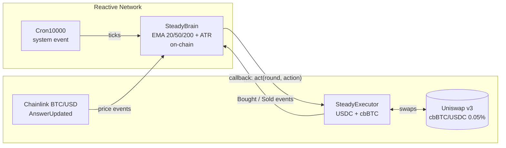

# Steady

**DCA that steps aside when the trend breaks.**

Steady is a weekly dollar-cost-averaging strategy for BTC that runs entirely on-chain, with no server, no bot and no keys online. A reactive contract on [Reactive Network](https://reactive.network) watches the Chainlink BTC/USD feed on Base, computes trend indicators on-chain, and tells an executor on Base when to buy, when to hold cash, and when to get out.

Built for the Reactive Omni Buildathon, track **Set It and Forget It**.

---

## Why

Plain weekly DCA is simple and it works over long horizons, but it keeps buying all the way down a bear market. In our backtest, a weekly BTC DCA started in January 2024 was down 20 percent by late November 2026 (ETH: down 35 percent).

The fix most traders reach for is a trend filter: buy while the trend is up, step aside to cash when it breaks. It is easy to describe and hard to run yourself, because a filter only helps if something watches the market every day and acts without hesitation. That is exactly what a reactive contract does.

| Out of sample, Jan 2024 to Nov 2026, weekly $ in | BTC return | BTC max drawdown | ETH return | ETH max drawdown |
|---|---|---|---|---|
| Plain weekly DCA | -20% | 55% | -35% | 67% |
| **Steady's rule: trend-gated DCA, exit on trend break** | **+6%** | **45%** | **+19%** | **46%** |

Backtest on Coinbase daily candles, 0.5 percent fee per side, signals on the close and fills at the next open, standard parameters with no tuning. The same rule held up at 0.9 percent fees (+2 / +16 percent). Code in [`research/`](research/). Past results are evidence, not a promise; see [Limits](#limits).

---

## How it works



**SteadyBrain** (reactive contract, Reactive mainnet) subscribes to three event streams:

1. **Chainlink BTC/USD `AnswerUpdated` on Base**, about 48 updates a day. The brain builds daily high, low and close from these updates and keeps EMA20, EMA50, EMA200 and a Wilder ATR14 on-chain. The regime is **UP** when the daily close is above EMA200 and EMA20 is above EMA50.
2. **Reactive's Cron10000** system event. Once a week the brain releases that week's budget, and buys with it if the regime is UP.
3. **SteadyExecutor's own `Bought` and `Sold` events on Base.** The brain's view of the position follows what actually happened on-chain, not what it hoped would happen.

It decides one of five actions and delivers it to Base as a callback:

| Action | When |
|---|---|
| `WEEK_ONLY` | weekly tick while the regime is DOWN: budget accumulates in USDC |
| `WEEK_AND_BUY` | weekly tick while the regime is UP: invest all idle budget |
| `BUY` | the regime just turned UP: invest the cash that waited |
| `SELL_TREND` | the regime just turned DOWN: exit to USDC |
| `SELL_STOP` | price fell below the disaster stop (last buy price minus 3 x ATR) |

**SteadyExecutor** (callback contract, Base) holds the USDC and cbBTC and only executes. Every swap is checked against the Chainlink price read directly on Base, with a 1 percent slippage limit, so there is no manually maintained price ceiling.

---

## Safety

- **Only the brain can act**, and only through Reactive's callback proxy (`onlyServiceProvider` plus `onlyCallbackSender`).
- **Idempotent.** Every action carries a round number; repeats are ignored. Reactive can deliver the same event twice.
- **Skip, never revert.** A stale oracle (older than 2 hours), a failed swap or a slippage breach records a `Skipped` event and the callback settles. Reactive bills failed callbacks and does not retry them, so reverting would only cost money.
- **Exits retry.** If an exit is skipped, no `Sold` event comes back, and the brain re-issues the exit at the next daily close until it lands.
- **The stop blocks re-entry** until the regime resets, so a crash does not trigger buy-sell churn.
- **Owner controls** on the executor: pause, withdraw any token, change the weekly amount or slippage. On the brain: pause and resume the paid subscriptions.

---

## Costs

| | Per | Notes |
|---|---|---|
| Price reactions | ~0.012 to 0.016 REACT each | about 48 a day |
| Cron ticks | ~0.014 REACT each | about 11 a day, billed whether or not anything happens |
| Total on Reactive | ~0.9 REACT a day | live mainnet fee parameters, Reactive MCP `estimate_cost` |
| Base callbacks | fractions of a cent of ETH | only on actions: weekly, and on regime changes |
| Swap cost | ~0.05% pool fee | forked mainnet round trip measured at about 0.10% |

---

## Repository

```
src/SteadyBrain.sol       reactive contract (Reactive Network)
src/SteadyExecutor.sol    callback contract (Base)
test/Steady.t.sol         13 tests: brain logic with a mocked system contract,
                          executor against a fork of Base mainnet
script/seed.py            seed EMAs and ATR from completed daily candles
script/deploy.sh          deploy, link, seed and fund both contracts
research/                 the backtest behind the rule
```

```bash
forge install Reactive-Network/reactive-lib-omni@3ade0dcf1d27e67e5783ef807e73a1b9e0c0cce8
forge test
```

The fork tests use `https://mainnet.base.org` by default; set `BASE_RPC` to use another endpoint.

---

## Deployments

| Contract | Chain | Address |
|---|---|---|
| SteadyBrain | Reactive mainnet (1597) | _to be filled after deployment_ |
| SteadyExecutor | Base (8453) | _to be filled after deployment_ |

Full-loop transactions (origin event, reactive transaction, callback): _to be filled after deployment_.

---

## Limits

- **A trend filter lags.** It gives back the start of every rally and pays for false switches in choppy markets. In the 2019 to 2023 backtest, plain DCA beat the gated version on ETH.
- **Small sample.** The out-of-sample period is under three years with fewer than ten regime switches per asset.
- **The 3 x ATR stop was chosen after seeing the data.** Treat it as a hypothesis the live run tests, not a proven edge.
- **On-chain ATR is approximate.** Daily high and low come from Chainlink updates (deviation and heartbeat), not every trade.
- **Seeded indicators.** EMA200 needs 200 days of history, so the brain starts from values computed off-chain from Coinbase candles, then advances on-chain from Chainlink.
- **Cron bills every tick.** A weekly strategy pays for about 77 ticks to act once. Cheap at current prices; budget it.

---

## Tools used

Foundry, `reactive-lib-omni`, and Reactive's own MCP server for planning subscriptions, generating templates, static checks (`check_rc_source`), cost estimates and post-deployment health checks.

## License

MIT
